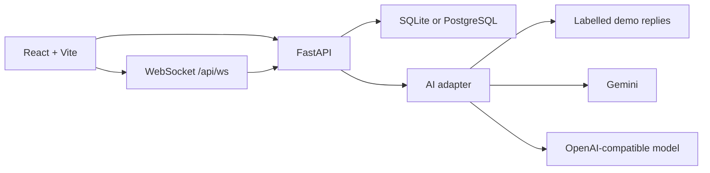

# HeartBridge

A supportive health community with a full-page AI companion, topic-based groups, direct messages, and labelled sample clinicians. HeartBridge is a prototype. It is not a clinic, a therapist, or an emergency service.

## Architecture



The API is a modular monolith. Route handlers stay thin. Safety checks, booking, and account deletion live in services. API keys never go to the browser.

## Deploying on Vercel with Neon

Create a Neon PostgreSQL project and copy its connection string with `sslmode=require`. In the Vercel project settings, add it as `DATABASE_URL` for every environment you deploy (Production and Preview as needed), then redeploy. Keep the connection string private; do not commit it to this repository. The backend build applies Alembic migrations before the deployment is served and fails if `DATABASE_URL` is missing or points to SQLite. Use separate Neon branches/URLs for Preview and Production if you want isolated data.

## What you can do

- Register, sign in, and complete onboarding with optional topics and privacy choices.
- Talk with the companion. Replies stream. You can stop, retry, regenerate, copy, and leave feedback. Chats can be searched, renamed, archived, and deleted.
- Choose light or dark appearance; the preference is saved in this browser and defaults to light.
- Use the companion microphone to dictate a message, then review and send it. Replies can be read aloud automatically or played individually with the speaker control; voice features use browser speech support.
- Use the composer’s plus menu to attach PNG, JPEG, or WebP images and PDF, TXT, Markdown, or CSV documents for Gemini analysis. Files are sent to the backend for the current reply and are not stored in chat history. Files are limited to 5 MB (text documents to 1 MB); only one file can be attached per message.
- If `GEMINI_API_KEY` is set, the companion uses Gemini through the backend. The existing OpenAI-compatible provider remains available as a fallback. With neither key configured, replies are clearly labelled demo text.
- Share posts, comment, react, save, and report. Visibility can be public, a community, or a private draft.
- Join or leave communities. Private groups require approval. Anonymous names work only where a group allows them.
- Send a message request. Ongoing chat starts after acceptance. Block, mute, and report are enforced on the server.
- Search sample clinicians by specialty, area, language, visit type, and accessibility. Book a demo slot. The server will not give the same open slot to two people.
- Export your data, change consent settings that the API actually reads, and delete the account.

## Run it

Python 3.11 or newer, Node.js 22, and npm are required. The default database is a SQLite file in `backend/`. PostgreSQL works if you set `DATABASE_URL`.

### Windows PowerShell

```powershell
cd backend
py -3.11 -m venv .venv
.\.venv\Scripts\Activate.ps1
pip install -r requirements.txt
copy ..\.env.example .env
alembic upgrade head
python -m app.seed
uvicorn app.main:app --reload --port 8000
```

In a second terminal:

```powershell
cd frontend
npm install
npm run dev
```

Open http://localhost:5173. API docs are at http://127.0.0.1:8000/docs. Health check: http://127.0.0.1:8000/api/health.

### macOS or Linux

```bash
cd backend
python3.11 -m venv .venv
source .venv/bin/activate
pip install -r requirements.txt
cp ../.env.example .env
alembic upgrade head
python -m app.seed
uvicorn app.main:app --reload --port 8000
```

```bash
cd frontend
npm install
npm run dev
```

## Demo accounts

Every sample password is `DemoPass123!`. The landing page can sign in as Maya or the admin directly.

| Email | Role |
| --- | --- |
| maya@heartbridge.demo | Member |
| arun@heartbridge.demo | Member |
| leila@heartbridge.demo | Member |
| samir@heartbridge.demo | Moderator |
| admin@heartbridge.demo | Admin |
| aisha@heartbridge.demo | Sample clinician |

All clinicians, posts, and appointments are fictional. Sample profiles are labelled in the interface.

## Environment

Copy `.env.example` to `backend/.env`.

| Variable | Purpose |
| --- | --- |
| `DATABASE_URL` | Local default: `sqlite:///./heartbridge.db`; Vercel: Neon PostgreSQL URL with `sslmode=require` |
| `JWT_SECRET` | Long random string. Change this before any shared deployment |
| `COOKIE_SECURE` | `true` only behind HTTPS |
| `ALLOWED_ORIGINS` | Browser origins allowed to call the API |
| `GEMINI_API_KEY` | Gemini key, read only by the backend |
| `GEMINI_MODEL` | Gemini model (default: `gemini-3.6-flash`) |
| `OPENAI_API_KEY` | Optional existing OpenAI-compatible provider fallback |
| `OPENAI_MODEL` | Used only when the OpenAI-compatible key is set |
| `OPENAI_BASE_URL` | OpenAI-compatible base URL |
| `UPLOAD_DIR` | Image upload directory; relative paths use `/tmp` on Vercel, where uploaded files are ephemeral |
| `AI_MAX_TOKENS` | Maximum response length; default is 1200 to allow detailed answers |
| `DEMO_BANNER` | Shows the fictional-data banner |
| `RATE_LIMIT_ENABLED` | Per-user and per-IP limits on auth, posts, messages, and AI |

## Tests

```powershell
cd backend
pytest
cd ..\frontend
npm test
```

Latest local run: 44 backend tests and 1 frontend test passed. The backend suite covers auth, feed visibility, topic personalization, AI safety, Gemini image and document streaming with attachment non-persistence, message permissions, booking conflicts including a concurrent reservation, export, and account deletion.

## API map

Authenticated routes use an HTTP-only session cookie.

- Auth: `POST /api/auth/register`, `POST /api/auth/login`, `POST /api/auth/logout`, `GET /api/me`, `DELETE /api/me`
- Feed: `GET/POST /api/posts`, reactions, comments, bookmarks, `POST /api/reports`
- Communities: `GET /api/communities`, join, leave, approve
- Messages: `POST /api/message-requests`, conversation messages, block, mute, `WS /api/ws`
- Companion: `GET /api/ai/status`, conversations, streaming `POST /api/ai/conversations/{id}/messages`
- ECG reports: authenticated `POST /api/ai/ecg-analysis` accepts one PDF, PNG, JPEG, WebP, or CSV report (up to 5 MB; CSV up to 1 MB) and returns a non-diagnostic plain-language explanation. Requires Gemini; report contents are sent to the configured Gemini provider and are not saved by this endpoint. No frontend upload control is included.
- Care: `GET /api/doctors`, slots, `POST /api/appointments`, cancel
- Privacy: consents, `POST /api/privacy/export-request`, journal, prep notes
- Moderation: `GET /api/admin/reports`, resolve, audit

## Data

Main tables: users, profiles, consents, posts, comments, reactions, communities, memberships, conversations, messages, ai_conversations, ai_messages, doctors, availability_slots, appointments, reports, notifications, audit_events. Migrations live in `backend/alembic/versions`. An active booking cannot share a slot with another active booking. Cancelling releases the slot.

## Safety behavior

Crisis, urgent-symptom, medication-change, and diagnosis requests are handled by a server-side policy before any model call. The companion will not claim to be a clinician, invent a provider, or say that you are safe. India emergency **112** and publicly listed helplines (AASRA, iCall, Kiran) are shown for crisis language, with a note to confirm them locally. This is not monitoring and not an emergency service.

## Before any public launch

This repository does not claim compliance with the DPDP Act, telemedicine guidelines, medical-device rules, or consumer law. Before real users:

- Have a qualified privacy review of health-related data, retention, and children's data.
- Have a clinical and legal review of companion copy, helpline numbers, and provider verification.
- Replace sample clinicians with sourced, verified records.
- Put the API behind HTTPS, set `COOKIE_SECURE=true`, and use a strong `JWT_SECRET`.
- Move rate limits and the WebSocket fan-out off a single process if you run more than one server.

## Limitations

- Demo replies are a transparent fallback, not a clinical model.
- Hindi and Telugu can be saved as a preference. The interface stays in English so health wording is not machine-translated.
- Message delivery uses a WebSocket plus polling. This is not end-to-end encryption.
- Email notification preferences are stored and are not sent.
- Provider verification in the demo is a label, not a credentialing workflow.
- No real-time hospital availability is integrated.

## Troubleshooting

- **Sign-in says the email or password is incorrect after seeding.** Run `python -m app.seed` from `backend` after `alembic upgrade head`.
- **The companion says demo mode.** Both `GEMINI_API_KEY` and `OPENAI_API_KEY` are empty. Add a provider key to `backend/.env` and restart the API.
- **Port already in use.** Stop the other process or change `--port` and the Vite proxy in `frontend/vite.config.ts`.
- **Cookies are not kept.** Use the Vite dev server so the browser talks to one origin. Do not open the API port directly for the app.
- **Alembic says the tables already exist.** Delete `backend/heartbridge.db` and run `alembic upgrade head` again, then seed.
